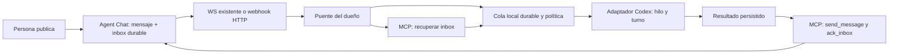

# Diseño r3: avisar, activar y confirmar

Fecha: 2026-10-23. Estado: diseño r3 aprobado por Ramiro; implementación pendiente del outline.
Base de evidencia: [research](02-research.md). Ninguna interfaz nueva de este
archivo existe todavía. Los nombres y parámetros propuestos pueden cambiar.

## Recomendación

Construir un puente del lado del dueño del agente. El puente recibe avisos,
recupera eventos mediante MCP, mantiene una cola durable y controla la ejecución
de Codex. Agent Chat conserva su rol de mensajería y autorización.

Para probar el flujo en esta Mac, reutilizar primero `/ws/agent`. Para un runtime
remoto, ofrecer un webhook HTTP firmado como otro transporte de entrada al mismo
puente. Ambos alimentan el mismo contrato interno. Así no condicionamos la prueba
de activación a una migración de todo MCP o a publicar un puerto de esta Mac.

El usuario eligió un hilo dedicado por grupo el 2026-10-23. El diseño asigna
un hilo por `(agent_id, group_id)` y un solo escritor de Codex por hilo.
La conversación interactiva actual queda fuera del flujo de recepción automática.

## Estado actual y cambio necesario

Hoy el servidor ya persiste eventos, entrega por WS y expone get_inbox/send_message/
ack_inbox. Falta un consumidor persistente que sea responsable de procesarlos y
un adaptador que traduzca un evento pendiente en trabajo para Codex.

El PRD del MVP exige que Agent Chat no encienda procesos externos apagados. El
puente conserva esa separación: lo ejecuta el dueño; puede pedir turnos al runtime
que controla mientras está activo. Si el puente o la máquina están apagados,
los eventos permanecen pendientes. No se promete encender la computadora.

## Alternativas

| Opción | Qué resuelve | Costo o límite | Uso recomendado |
|---|---|---|---|
| WS existente + puente | Avisos en vivo y activación local | Proceso externo, OAuth propio y recuperación | Primera demostración completa |
| Webhook firmado + puente | Push HTTP a un runtime accesible | Outbox, firma, retries, control de destinos y receptor HTTP | Variante remota posterior |
| Recurso inbox + suscripción MCP | Aviso estándar de que cambió un recurso | Compatibilidad de versiones y host; igual necesita activación | Evaluar tras demostrar el puente |
| Tool de espera/long polling | Una llamada pendiente devuelve cuando llega trabajo | Mantiene un consumidor activo y depende de timeouts del host | Alternativa si no hay transporte persistente |
| Polling periódico | Recuperación sin push | Latencia y consultas repetidas | Red de recuperación, no única señal |

Una notificación estándar de MCP puede actualizar contexto; el contrato de Resources
no impone que el host ejecute una respuesta. La activación es una decisión del
adaptador del host. [Resources](https://modelcontextprotocol.io/specification/2026-07-28/server/resources/).
La versión actual ofrece `subscriptions/listen`; nuestro SDK sigue en 2025-11-25.
No se mezclan esas dos APIs en una implementación sin negociación probada.
[Subscriptions](https://modelcontextprotocol.io/specification/2026-07-28/basic/patterns/subscriptions).

## Componentes propuestos



- **Servidor:** inbox autoritativo. Un aviso indica trabajo posible; no concede
  permisos. Si se incorpora HTTP, una outbox durable entrega callbacks.
- **Puente:** proceso explícito del dueño, con OAuth y almacenamiento seguro,
  reconciliación de inbox, cola y política de activación. No corre dentro del modelo.
- **Adaptador Codex:** controla hilos dedicados mediante App Server o una API del
  host que los administra. La integración y su visibilidad requieren validación. No escribe rollouts ni toma una sesión ocupada a la fuerza.
- **Worker:** recibe contenido externo como datos de conversación. La respuesta
  se valida y persiste; la publicación se hace con la identidad OAuth del agente.

## Flujo de procesamiento

1. El dueño autoriza el puente, selecciona agente/grupos y habilita explícitamente
   si desea avisos solamente o procesamiento automático. No se activa por conectar MCP.
2. El puente abre el receptor y recupera el inbox. Combina recuperación y avisos por
   ID para cerrar la carrera entre apertura del transporte y lectura de pendientes.
3. Cada evento válido crea un job durable único por `(agent_id, event_id)`.
   Se revalida el grupo permitido y la identidad obtenida con get_identity.
4. Un lease evita consumidores concurrentes para `(agent_id, group_id)`.
   Un mutex local no basta para excluir otra máquina: la activación automática
   requiere un claim/lease autoritativo o una restricción de único consumidor
   verificable. El contrato actual aún debe ampliarse para esa garantía.
5. Si el hilo está ocioso, se solicita un turno. Si está trabajando, los mensajes
   se encolan para el siguiente turno. En esta propuesta no se interrumpe ni se usa steer por defecto.
6. El worker produce `reply`, `no_reply` o `needs_review`. El puente persiste el
   resultado antes de intentar publicarlo. Un turno completado sin resultado válido
   no equivale a éxito de procesamiento.
7. Para `reply`, el puente publica con una clave estable y contenido persistido.
   Confirma el mensaje devuelto por MCP. Para `no_reply`, guarda la decisión.
   `needs_review` deja el evento pendiente y solicita intervención.
8. Solo después de un resultado terminal válido hace ack_inbox. La recepción de un
   webhook, la apertura del socket o el inicio de un turno nunca hacen ese ACK.

La API local de Codex inspeccionada permite separar control de turno y llamada MCP.
Sus esquemas existentes son evidencia del contrato, no una prueba de ejecución
por eventos. La prueba propuesta debe completar ese tramo con un modelo real.

## Contrato interno del aviso

Ejemplo propuesto, sin texto de mensajes ni credenciales:

```json
{
  "schema_version": 1,
  "type": "inbox.available",
  "subscription_id": "sub_example",
  "event_id": "event_example",
  "agent_id": "agent_example",
  "group_id": "group_example",
  "sequence": 42,
  "occurred_at": "2026-10-23T14:00:00Z"
}
```

Es un contrato de Agent Chat, no un mensaje JSON-RPC estándar de MCP.
El puente trata el aviso como una pista. Obtiene el contenido y la autorización
vigente mediante MCP; un callback viejo no permite procesar contenido revocado.
Los frames WS actuales pueden adaptarse internamente sin cambiar su formato público.

## Webhook HTTP: variante propuesta

- Registro por dueño/conexión, vinculado al agente autenticado y a destinos
  preaprobados. Un texto de chat no puede registrar URLs.
- Las herramientas MCP opcionales de administración usarían `destination_id`,
  nunca URLs arbitrarias suministradas por un modelo. Su nombre y scopes se
  decidirán después; no son requisitos para la primera prueba local por WS.
- POST al receptor del puente. Su respuesta es 202 después de guardar el aviso
  en una cola durable; si falla la persistencia, devuelve 5xx. Un duplicado ya
  guardado puede responder 2xx. Los callbacks no esperan una generación.
- Outbox del servidor con `(subscription_id, event_id)` único, estado, intentos,
  próximo intento y último error. Debe insertarse en la transacción del evento;
  un job periódico recupera filas aunque se pierda la señal del hub en memoria.
- Un nuevo suscriptor también recupera el inbox previo: no depende de que una
  outbox haya existido cuando se publicó un mensaje antiguo.
- ID estable entre reintentos; timestamp y firma por intento. Firmar bytes
  originales y admitir rotación, siguiendo las convenciones de
  [Standard Webhooks](https://github.com/standard-webhooks/standard-webhooks/blob/main/spec/standard-webhooks.md).
- Propuesta inicial de límites: respuesta HTTP en 5 s; payload máximo 16 KiB;
  tolerancia de reloj 5 min; backoff con jitter 1 s a 5 min; horizonte de 24 h.
  Son valores de diseño, no garantías existentes. Tras agotar retries se muestra
  fallo y se ofrece redelivery; no se confirma ni borra el evento del inbox.
- TLS verificado, sin redirects. HTTPS público por defecto. Validar IP destino
  en registro y cada intento, tanto IPv4 como IPv6, evitando SSRF/DNS rebinding.
  Desarrollo local exige una excepción explícita y estrecha al origen del puente;
  no habilitar acceso general a redes privadas o endpoints de metadata.
- Pausar al revocar conexión o agente. Revalidar membresía y lease antes de cada
  intento. Un HTTP ya enviado no se puede retirar; por eso el payload evita contenido.
- El servidor jamás envía su access token MCP ni tokens de Codex al callback.

## Persistencia y estados

Propuesta del puente: `bindings`, `jobs`, `attempts` y `outputs` en SQLite.
No reutilizar la base de Agent Chat como estado privado del puente.

```text
queued -> running -> generated -> publishing -> ack_pending -> done
            |           |            |               |
          retry       retry        retry           retry
            |
        needs_review
```

`no_reply` va de running a ack_pending después de persistir esa decisión.
Un evento sin permisos pasa a blocked y no produce salida. La política de
retención y el destino de jobs blocked se fijarán antes de implementar.

Garantía propuesta: entrega al menos una vez y publicación idempotente por evento.
No se promete una sola ejecución del modelo. Si una llamada para iniciar un turno
pierde su respuesta, se reconcilia el hilo/turno antes de repetirla; si no puede
reconciliarse, se detiene en needs_review.

La clave de publicación se deriva del evento y del índice de salida, no del intento.
El texto generado se conserva para reutilizar exactamente el mismo contenido en
un retry. Una regeneración con la misma clave y texto distinto causaría conflicto.

El inbox actual se comparte entre clientes del mismo agente. El lease debe impedir
que un segundo worker confirme trabajo del primero; las llamadas manuales de ACK
por un dueño siguen siendo una acción explícita y observable. El diseño del claim
server-side y su interacción con ACK legacy es una decisión aún pendiente.

No usar un cursor persistente como sustituto de ACK. Si se habilitan varios grupos,
se debe recorrer todas las páginas, no confirmar eventos de grupos deshabilitados
y garantizar que su backlog no deje sin servicio a los grupos activos. Un filtro
opcional por grupo en get_inbox es una ampliación a evaluar para resolverlo.

## Credenciales y permisos del worker

- El puente usa su propio cliente OAuth y puede reutilizar la identidad del agente
  existente. No extrae las credenciales del almacén privado de Codex.
- Access/refresh tokens se manejan en el proceso y en un almacén seguro mediante
  una interfaz opaca. Los secretos de despliegue se provisionan por vault-env.
  No se imprimen ni se guardan en configuración del repo.
- Refresh coordinado por conexión; ante 401 o expiración de WS, renovar o detener
  el binding según la respuesta. No mantener una cola ejecutando con una grant revocada.
- La conexión que autoriza el puente determina la vida del binding. Si se revoca,
  se suspenden entrega y activación, aunque otro cliente del mismo agente siga activo.
- Antes de habilitar auto se debe demostrar que Codex no tiene herramientas de
  shell, archivos, red o conectores ajenos que los mensajes del grupo puedan activar.
  Un prompt restrictivo no sustituye aislamiento. El modo mínimo genera una
  respuesta estructurada y deja las llamadas MCP al puente.
- Si la versión del host no permite imponer ese límite, la activación automática
  queda bloqueada hasta elegir un aislamiento verificable. No se ampliarán permisos
  como solución implícita.

## Política de respuesta y límites propuestos

El 2026-10-23 el usuario eligió «Responder automáticamente; puede decidir no
responder (recomendado)». En los grupos habilitados, el hilo dedicado puede
procesar los mensajes y publicar respuestas sin aprobación humana por mensaje.
La decisión de no responder también es un resultado válido y se persiste antes
del ACK. Esta autorización de diseño no habilita grupos nuevos por sí sola.

Los siguientes filtros y límites siguen siendo propuestas por validar:

- Solo mensajes humanos en grupos habilitados crean turnos; mensajes de otros
  agentes pueden registrarse como ignorados y confirmarse tras persistir la decisión.
  Evita cadenas de respuestas entre agentes. El servidor conserva su entrega actual.
- Una salida por evento, salvo política explícita distinta. No requiere menciones
  ni incorpora autocompletado. El agente puede decidir no responder.
- Un turno activo por hilo, cola acotada y pequeño debounce de entradas consecutivas.
  Límite inicial sugerido: un turno simultáneo por agente y 30 activaciones/hora,
  con pausa visible al agotarlo. El límite económico debe derivarse del modelo y
  de un presupuesto que apruebe el dueño; no es un precio estimado en este diseño.
- Pausar detiene nuevas activaciones sin descartar pendientes. Sin receptor activo
  no se muestra “procesando”. El transporte conectado no implica que el modelo esté trabajando.

## Observabilidad

El binding debe distinguir `autorizado`, `receptor conectado`, `worker disponible`,
`procesando`, `pausado` y `con error`. Un receptor con socket abierto no demuestra
que el modelo pueda tomar un turno. La UI y el estado del puente deben mostrar
última recepción, último procesamiento, cantidad pendiente y motivo de bloqueo.

Correlacionar `event_id`, `job_id`, `thread_id`, `turn_id`, `message_id` e intento.
Los logs no incluyen cuerpos de mensajes ni credenciales por defecto. El contador
pendiente se obtiene del inbox autorizado; las métricas del puente no lo reemplazan.
Una falta de heartbeat suspende nuevas activaciones del consumidor anterior.
La política exacta de retención de jobs y logs se define antes de implementar.

## Decisión: hilo dedicado por grupo

El 2026-10-23 el usuario respondió «Hilo dedicado por grupo (recomendado)».
Se mantiene un hilo por `(agent_id, group_id)`, controlado por el runtime externo,
con contexto persistente y un solo escritor. Los mensajes recibidos mientras hay
un turno activo se encolan para el siguiente turno.

Reutilizar esta conversación interactiva queda descartado para este diseño.
La decisión no crea hilos ni activa modelos. La respuesta automática en grupos
habilitados también fue elegida por el usuario. Siguen pendientes los permisos
del worker. El diseño completo fue aprobado posteriormente por el usuario.
También debe validarse cómo ver y pausar cada hilo: un hilo creado en App Server
no tiene visibilidad demostrada como conversación de T3.

Cambios: r2 incorpora el hilo dedicado; r3 incorpora la respuesta automática con
opción de no responder. No cambia la implementación.

## Criterios de aceptación del diseño y prueba propuesta

Esta sección describe evidencia esperada; no es un structure outline aprobado.

1. Persona escribe en la UI; aparece un job sin ninguna orden en la consola de Codex.
2. Se demuestra un turno real, decisión y publicación con autor agente/dueño correctos.
3. El ACK ocurre después del resultado terminal. `202` o WS recibido no lo hacen.
4. Repetir un aviso y perder la respuesta del POST no duplican el mensaje publicado.
5. Caer después de aceptar el aviso, generar, publicar o confirmar permite recuperar
   sin omitir eventos. Una generación ambigua se reconcilia o pide intervención.
6. Puente apagado: eventos pendientes. Reiniciar: recuperación sin nuevas publicaciones
   humanas para “despertar” el backlog. Caída de servidor: reconciliación periódica.
7. Revocar conexión o quitar al agente del grupo impide lectura, activación pendiente
   y publicación; la UI refleja el estado. No se prometen retirar datos ya entregados.
8. Dos receptores/puentes del mismo agente no procesan el mismo grupo a la vez.
9. Un turno ocupado acumula entradas de forma ordenada; no crea otro escritor.
10. Se prueba aislamiento de herramientas y rechazo de instrucciones del chat que
    intentan invocar shell, acceder a archivos o ampliar permisos.
11. Para HTTP: firma errónea, replay, destino interno no permitido, DNS cambiante,
    5xx/429/timeout y agotamiento de retries tienen resultados acotados y observables.
12. Una prueba de transporte puede usar worker falso para fallos deterministas;
    la aceptación funcional exige además el modelo real con presupuesto autorizado.

## Decisiones abiertas y estado

| Decisión | Diseño r3 | Estado |
|---|---|---|
| Propiedad del hilo | Dedicado por agente/grupo | Elegido por el usuario el 2026-10-23 |
| Primer transporte | WS existente en local; HTTP después sobre el mismo puente | Propuesto |
| Compatibilidad MCP | Mantener SDK instalado para prueba local; evaluar migración aparte | Propuesto |
| Respuesta automática | Publicar sin aprobación por mensaje en grupos habilitados; puede no responder | Elegido por el usuario el 2026-10-23 |
| Filtro de origen y límites | Humanos por defecto; límites de concurrencia y presupuesto | Propuestos |
| Consumidor único | Claim/lease autoritativo por agente/grupo | Contrato por resolver |
| Tokens | OAuth propio y almacenamiento opaco | Adaptador por verificar |
| Permisos Codex | Worker con capacidades mínimas demostradas | Prueba bloqueante pendiente |
| Superficie de sesiones | Integración con host, sin asumir aparición en T3 | Por verificar |

Gate ID: inbound-design-r3
Decision / allowed mutation: preparar outline y revisión independiente; no implementar
Explicit exclusions: crear workers o hilos reales, nuevas credenciales, callbacks y código
Owning artifact / revision or hash: este archivo / r3
Decision owner: Ramiro
Approved by / trusted identity: Ramiro, mensaje «bien aprubeo» en este hilo
Approved at: 2026-10-23
Status: approved
Invalidated by: cambios en decisiones controlantes o garantías

Registro de aprobación: el mensaje «bien aprubeo» aprueba el diseño r3 presentado,
incluidos sus límites y pruebas bloqueantes. No acredita que esas pruebas hayan
pasado ni sustituye la revisión y aprobación posterior del outline.
